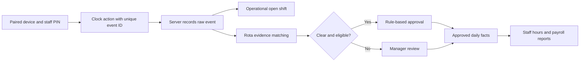

# Care Operations Platform: Kiosk, Staff App and Communication

This technical companion to the [main case study](care-operations-platform.md) explains how the attendance device, staff interfaces and messaging fit into the wider care workflow. It describes capabilities visible in the private implementation without publishing source code, operational settings or staff data.

## Kiosk clocking: capture first, decide later

The shared-device kiosk has an authorised pairing lifecycle, device status and heartbeat checks, staff PIN clock-in/out, optional photo evidence, offline queueing and a manager-facing punch log. It also has distinct visitor and agency entry workflows. Those records are not mixed into the normal staff payroll path.

### What makes the record reliable

- **Authorised device and identity:** the server checks the paired device and an active kiosk identity before accepting a staff action. The kiosk identity is linked to the approved staff record, while its PIN and device state remain separate from the HR profile.
- **Raw event retained:** a valid IN or OUT is recorded before the system interprets it as an open or closed shift. If interpretation is uncertain, the event can still be reviewed; the screen should say that the clocking was saved without promising payable time.
- **Unique retry identity:** a clock action carries an event identifier, allowing an exact retry to return its original result rather than create another attendance event.
- **Server and offline time:** online receipt uses server time. An offline action waits in the device queue and is not treated as server-accepted until synchronisation succeeds. The server bounds any device-supplied offline time before using it as effective time.
- **Repeat and exception handling:** same-action repeats and very short accidental IN/OUT pairs remain in technical evidence but do not form another ordinary attendance or automatic-pay candidate. Missing clock-outs, overlapping or ambiguous events, edited rota rows and other exceptions require review.
- **Photo handling:** where enabled, a punch photo is linked as separate evidence. A photo-upload failure is logged without corrupting the already recorded clock event. The project does not claim facial recognition or biometric identity verification.

The kiosk also maintains the operational open-shift state used by the current-on-site and fire-list views. A safety auto-close is a flagged operational cutoff, not a genuine clock-out or approved paid time. The pay decision comes later from planned shifts, raw evidence, manager outcomes, leave and contract rules.

## Staff mobile app and desktop workspace

Staff have separate mobile and desktop surfaces backed by their portal account and linked staff record. The implemented self-service experience covers:

- a dashboard with upcoming rota and request context;
- published shifts, open-shift and swap requests;
- leave requests and their status;
- training due/expired awareness and booking responses;
- profile and kiosk-PIN tasks;
- policy review and version-specific read acknowledgement;
- assigned audit actions when that optional feature is enabled.

The hours screen has a strict presentation rule: it shows worked/paid minutes only from approved authoritative daily facts. A planned shift or a punch that is not yet payroll-ready appears as **Pending**, rather than displaying provisional hours as final. For assigned audit actions, staff can submit a completion note and evidence; a manager performs the final review and closure.

Staff login is separate from management login. A staff portal account does not by itself grant dashboard permissions, and staff-submitted profile changes go through a review path before becoming the approved HR record.

## Messages, alerts and notification boundaries

The Communication module stores a message and each recipient's read/response state. A manager workbench can send to one person or a defined staff audience. Staff desktop and mobile inboxes can display messages, read state and requested responses; the applicant surface also has a messages panel where applicable. A response can include a note, but it must match the response type requested by the original message. Expiring announcements disappear from recipient views while remaining in manager history.

Email is an optional short alert that a message is waiting; the detailed message stays in the application. Automatic producers use a deduplication key to avoid repeat delivery. A training-expiry producer is registered but disabled by default. The Communication feature itself is off by default and requires explicit activation for an installation. Other workflow emails, such as recruitment and access messages, have their own delivery paths.

This is an **inbox and response workflow**, not a live chat system. Staff-to-staff chat, reply threads and push notifications are not presented as implemented features. A previous local read-only AI chat integration was a removable test and has been retired, so it is not described as an active platform capability.

## Engineering significance

The same person crosses several trust boundaries: shared device, staff portal, manager decision and payroll report. The implementation keeps those boundaries explicit. A clock action can be accurate as evidence without automatically becoming an approved shift; a staff app can be useful without showing unapproved pay figures; and a message can be auditable without pretending to be a full chat product.

These are documentation notes only. No private source, credentials, staff records or deployment configuration are included.

