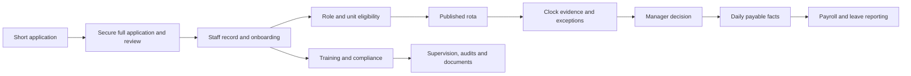
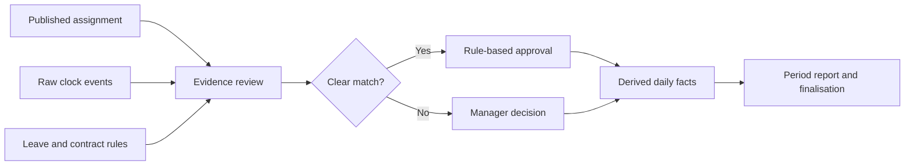

# Care Operations Platform

A modular PHP application for care workforce administration, scheduling, attendance, payroll preparation and quality assurance. This case study is based on the private architecture and module documents, checked against pages, services and schema. It contains no application source or operational data.

## The operational problem

Recruitment, staff records, training, rota planning, clock evidence, leave and payroll are connected in real work, but each has different rules and owners. A manager needs to see one person's journey and make decisions with evidence. A payroll report must reflect approved work, not simply a planned shift or an unchecked clock event.

## My engineering contribution

I worked across the platform architecture, data model and connected modules, from recruitment and staff onboarding through rota, attendance and payable-hours reporting. I also built or extended workflows for training, supervision, audits and protected documents. The work spans PHP services and controllers, SQL schema, admin and staff interfaces, permissions, background jobs and focused regression checks.

## How the platform fits together

The application has separate surfaces for a shared attendance device, managers, staff desktop and mobile use, and purpose-scoped applicant actions. Core business rules sit in services behind these interfaces. A separate maintenance area owns installation and schema repair.

Applicant information, the approved staff profile, the login account and the attendance-device identity are deliberately separate records. Hiring and account linking connect them through controlled steps. A rota assignment's worked unit and role define the context for that shift; the person's default department or eligible roles do not replace the assignment.

## Example 1: application to staff record

1. An applicant sends a short application for an advertised role without creating an account. A manager can also start a draft invitation.
2. Depending on the site setting, the full application invitation is sent automatically or after manager review. The applicant follows an expiring, revocable link scoped to that application.
3. The full application is saved in steps, then locked after declaration and submission. Interview, offer, reference and evidence checks remain traceable.
4. An authorised manager approves conversion to a staff record. Relevant application documents can be copied into protected staff documents with their origin retained and duplicates avoided.
5. New-starter onboarding tracks contract and consent evidence, profile and access setup, required training and induction. Staff authentication and attendance-device credentials have their own lifecycle.

The design avoids silently promoting unverified applicant data into the staff profile. Manager decisions and document provenance remain visible after conversion.

## Example 2: planned shift to payable time

1. A manager plans shifts in a weekly rota, using templates, publication, open shifts and swaps where appropriate.
2. A paired attendance device records clock events. Matching logic relates evidence to the intended assignment while keeping raw punch history.
3. Clear matched attendance can be approved automatically under configured rules. Edited plans, ambiguous punches, leave conflicts and other exceptions remain for manager review.
4. The manager records the approved outcome. Payable time is derived from that decision, actual evidence, approved leave and contract rules for the date.
5. A refresh process builds daily payable facts for reporting. Period finalisation protects accepted rows; reopening is an explicit controlled operation.

The payroll logic handles paid or unpaid breaks, weekly overtime allocation, weekend and bank-holiday premium minutes, overnight work and leave. Contract hours changes are time segmented for annual-leave calculations. Stored daily facts are derived reporting data; rota, decisions and clock records remain the underlying evidence.

## Other connected modules

| Area | Implemented engineering detail |
| --- | --- |
| Training and compliance | Catalogue, role requirements, staff assignments, sessions, attendance, completion evidence, approval/history and a real-data training matrix. Approved paid training can feed payroll facts. |
| Supervisions | Reusable or blank templates, scheduled meetings, answers and notes, follow-up actions, employee acknowledgement, supervisor sign-off and locking. |
| Audits | Configurable templates and question bank, draft runs, required evidence, scoring, findings, action ownership, activity history and printable reports. |
| Policies | Versioned rich-text documents, controlled release to staff groups and acknowledgement against the exact version. |
| Documents | Protected files in staff, recruitment, training, audit and service-certificate workflows; a central index/search workbench with source-aware access. |
| Agency and daily operations | Agency clocking and approved-hours export, plus room/resident daily presence and supplier/service-certificate records. |

[Explore the detailed module map](care-operations-module-map.md) for the workflow and implementation boundaries behind these areas.

## Document intake and scanning

The document work includes protected upload and viewing, multi-file evidence handling, review state and a cross-source Document Hub index. A developer-oriented scanner intake service watches a private folder, stores incoming PDF/image files, uses filenames or supplied sidecar hints to suggest document type and owner, and can auto-file a strong staff match. Unclear items enter a review queue. This scanner foundation does **not** perform OCR itself; external OCR execution and a full manager review workflow are pending. A separate document-processing service is described in its own [case study](document-processing-service.md).

## Engineering decisions

- **Separate evidence from approval.** A rota row and clock punch are inputs; an approved payable outcome is a business decision. Exceptions remain reviewable.
- **Keep one owner for each record.** Applicant, staff, login, kiosk and document records are linked without allowing one module to overwrite another module's authoritative data.
- **Protect access at the action and data level.** Management pages use permission checks and organisational scope; staff interfaces expose their own records and released materials.
- **Preserve history.** Applications, document provenance, policy versions, audit actions, supervision sign-off and payroll finalisation retain evidence for later review.
- **Use derived facts for repeatable reports.** Payroll views read refreshed daily facts while preserving source records and showing stale or incomplete data as attention items.

## Scope and verification

The private repository contains the pages, services, schema and focused tests behind the modules described here. Some features are foundations or optional modules, as noted above. This case study does not claim a number of customers, live users, measured time savings or deployment scale. No application source, credentials, private documentation or customer records are published here.

