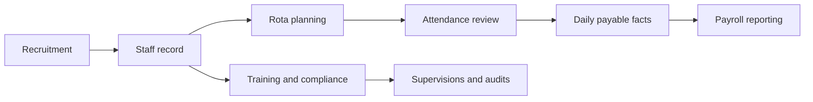

# Care Operations Platform

## The problem

Care organisations need to connect recruitment, staff records, compliance, training, scheduling, attendance and payroll preparation. Each workflow creates evidence and decisions that managers need to review without losing the underlying history.

## Platform design

A modular PHP and SQL application separates public attendance devices, management dashboards, applicant actions, and staff desktop and mobile experiences. Applicant, staff, authentication and kiosk records have distinct ownership rules. Operational data remains in its source tables, while derived daily payroll facts support consistent reporting.

## My engineering work

I worked across the platform architecture, database design and connected operational modules. The most significant design work was keeping applicant, staff, authentication and kiosk identities separate while allowing authorised workflows to move a person from recruitment through employment. I also worked on how planned shifts, clock evidence, manager decisions and contract rules become reportable payable time.

## Implemented workflows

### Recruitment and staff

- Public short applications and secure, expiring links for the full application, interview, offer and reference stages.
- Manager review of checks and evidence, followed by conversion from applicant to staff record.
- Staff profiles, contract changes, onboarding tasks and review of staff-submitted profile changes.
- Separate staff access for desktop and mobile, including rota, hours, leave and training views.

### Scheduling, attendance and pay preparation

- Weekly rota planning, reusable shift templates, publication, open shifts and shift swaps.
- Paired kiosk devices, clock events and manager review of attendance against planned shifts.
- Approval rules that distinguish raw punches from payable time.
- Daily payroll fact generation, refresh and period finalisation, including contract break rules, overtime and premium calculations.
- Annual-leave calculations that account for employment start, leave-year policy and changes in contract hours.

### Compliance and quality

- Training catalogue, role requirements, staff assignments, sessions, completion evidence and matrix reporting.
- Supervision templates, scheduled meetings, recorded answers, follow-up actions, acknowledgement and sign-off.
- Audit templates and question bank, scored runs, evidence, findings, assigned action plans and reports.
- Protected document storage and a central document workbench spanning several source modules.
- Versioned policies with staff review and acknowledgement tracking.
- Supplier and service-certificate records, renewals and protected document uploads.

### Operations and communication

- Agency-worker attendance with manager approval and export of approved hours.
- Room, resident and daily-presence records.
- Staff communications with inbox, response and targeted audience support.

## Technologies

PHP, SQL, server-rendered interfaces, REST-style APIs, JavaScript, background jobs and responsive staff interfaces.

## Design decisions

- **Keep raw evidence separate from decisions.** A clock event is evidence of attendance; it does not automatically become a payable shift. Managers can review exceptions before payroll facts are finalised.
- **Give each record a clear owner.** Applicant data, staff profiles, login accounts and kiosk identities have different sources of truth, reducing accidental overwrites during onboarding and profile changes.
- **Track compliance as workflows.** Training, supervision and audits include evidence, review states and follow-up actions rather than a single completion flag.

## Scope and status

These workflows are represented in the private code and current module documentation, but some areas are foundations or are still evolving. For example, supplier certificate reminders and richer resident reporting are planned rather than presented here as finished. The case study does not state deployment scale or measured business outcomes.

