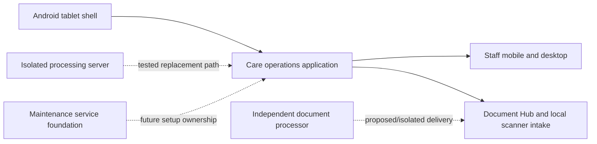

# Care Platform Engineering Ecosystem

The [care operations case study](care-operations-platform.md) describes the main application. The wider work consists of several separate repositories with different purposes. This page maps them without treating a prototype, copied integration branch or planned rebuild as a production feature of the current application.

## Current application and device work

| Separate project | Engineering content | Current boundary |
| --- | --- | --- |
| Care operations application | PHP and SQL business system covering recruitment, staff, rota, attendance, payroll preparation, training, audits, supervision, documents and staff interfaces | Main implemented application. Individual modules vary in maturity and enablement. |
| Android kiosk shell | Native Android WebView host for the remote kiosk UI, immersive display, screen-on behaviour, camera permission and a JavaScript bridge | The shell hosts the web kiosk. A native face-photo capture hook exists, but facial recognition is not an implemented clocking identity check. |
| Staff mobile and desktop surfaces | Portal authentication, personal rota/hours/leave/training views, requests, policy review and optional action/message views | Part of the care application, with its own staff access boundary separate from manager login. |

The browser kiosk and the Android shell play different roles. The Android app presents the hosted UI and supports device capabilities. The care application authorises the device, records clock events and evaluates attendance evidence. [The kiosk and staff app deep dive](care-operations-kiosk-and-staff-app.md) explains that path.

## Independent services and integration work

| Separate project | Engineering content | Current boundary |
| --- | --- | --- |
| Document processing service | Python API, direct PDF text extraction and OCR, job/review states, configurable document patterns, protected delivery and a PHP connector package | Independent processing has been developed and tested in isolation. Complete automatic filing into every care application workflow is not claimed. [Details](document-processing-service.md). |
| Processing server and isolated application copy | Laravel service with signed, source-bound attendance and payroll-related evaluation contracts; a separate client copy explores guarded use of these results | Component and synthetic verification exist. The replacement workflow is not presented as the live approval/payroll authority of the main application. |
| Automation-focused client and server | A new Laravel client login/dashboard foundation and a separate processing server foundation | Early rebuild. Business modules are not represented as migrated or operational. |
| Independent maintenance service | Separate container/status foundation intended to own future installation, migration and seed work | Health/status foundation only; no operational migration engine or customer database access is claimed. |

## Future platform direction

A further AI-first, multi-tenant product project contains planning, module rules and a Laravel skeleton. Its design explores tenant boundaries, add-on modules and a staged document-intake approach. It is a foundation and design project, not a completed SaaS product. The current application remains the evidence for implemented care workflows.

## What the combined work demonstrates

These projects show more than a single PHP website: shared-device capture, native mobile hosting, staff self-service, business-rule services, document processing, background work, signed cross-system contracts, isolated deployment and careful migration planning. Their separation also matters technically. Each project has its own source, status and trust boundary; a demonstrated component is not automatically active in the operational application.

This public overview contains architecture notes only. It includes no repository source, deployment configuration, credentials or operational records.

