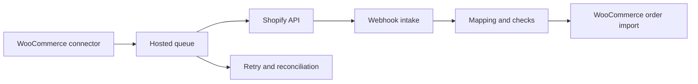

# Commerce Integration Service

## The problem

Merchants using WooCommerce and Shopify need product and stock changes to reach Shopify and Shopify orders to reach WooCommerce without duplicate records or fragile manual re-entry.

## The solution

A WooCommerce plugin works with a hosted PHP service. The connector sends product snapshots and applies incoming order commands. The hosted service processes queued work, communicates with Shopify, maintains mappings and reconciles orders.

## My engineering work

I developed the connector and hosted-service integration across product, stock and order flows. The work includes API and webhook handling, background processing, record mappings and checks that reduce duplicate or ambiguous updates.

## Engineering detail

- WooCommerce connector and hosted service boundary
- Shopify authorization and webhook processing
- Product and variation mapping with safeguards for ambiguous matches
- Background jobs, retries and reconciliation
- Order import with checks to avoid repeating unchanged work
- Synthetic connector and service test programs

## Technologies

PHP, WooCommerce, Shopify APIs, webhooks, queues and SQL storage.

## Design decisions

- **Separate store hooks from external API work.** The WooCommerce connector captures changes while the hosted service processes queued requests and retries.
- **Keep explicit mappings.** Product, variation and order identifiers need a durable relationship across platforms; ambiguous matches are held for review.
- **Make repeat delivery safe.** Webhooks and retries can repeat, so order import checks whether incoming work would change an existing record.

## Status

The private project contains the connector, hosted service and tests. This case study does not state merchant volume or a measured reliability result.

