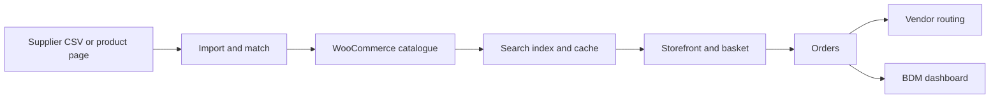

# Custom Commerce Platform

## The problem

A business WooCommerce storefront needed more than standard catalogue and checkout pages. It needed fast product discovery, customer-specific buying, business development reporting, supplier catalogue updates and order administration.

## My engineering work

I developed the custom theme and worked on site-specific plugins and import tooling. The work connects the public storefront to business operations: supplier products enter the catalogue, customers see relevant prices, orders reach vendors, and BDMs can review their assigned clients and commission.

## Storefront and account work

- A modular custom theme for the homepage, catalogue, product pages, search, basket and account views.
- Indexed product search with ranking and typeahead suggestions; product changes refresh the index, and a scheduled reconciliation checks stale entries.
- An instant basket with browser-side interaction and a synchronisation step into WooCommerce before checkout.
- Customer and business development manager (BDM) dashboards, quote requests, reorder and invoice access.
- Route-specific JavaScript bundles, conditional asset loading, minified production assets and catalogue cache invalidation designed to reduce unnecessary work on each page.

## BDM workflow

- The dashboard groups customers assigned to each BDM and shows their orders and recent activity.
- Sales from qualifying assigned-customer orders feed a tier-based commission calculation. Commission structures support monthly, quarterly and annual periods; the dashboard includes a monthly overview and tier progress.
- Sales metrics, trends and leading customers, products and categories help the BDM review their portfolio.
- Customer registration, follow-up prompts, savings calculations and price comparisons support day-to-day account work.

## Product import and automation

- Supplier catalogue preparation converts source product data into WooCommerce import fields, including SKU, descriptions, categories, prices, vendor references and image links.
- One supplier workflow can update prices from CSV or create/update a product from a product-page URL, extracting descriptions, technical details and images where available.
- A separate image-import workflow matches rows to products by SKU, processes them in batches, downloads images with retry controls and can fall back to the supplier page when an image URL is missing.
- Image preparation scripts convert source images to WebP and write an import-ready CSV plus an error report.
- Site-specific plugins also cover customer pricing, bulk product edits, scheduled supplier synchronisation options, vendor order routing, partial orders, reports and PDF catalogues.

## Technologies

WordPress, WooCommerce, PHP, JavaScript, Playwright-based catalogue preparation, Tailwind CSS, esbuild, SQL, AJAX and scheduled jobs.

## Design decisions

- **Keep operational features in focused plugins.** Pricing, supplier updates, reporting and routing can evolve without turning the theme into one large business-logic file.
- **Match supplier records deliberately.** SKU and supplier references support updates to existing products, while import reports expose rows that could not be processed.
- **Reduce unnecessary page work.** Route-specific assets and cache invalidation support faster loading without claiming an unmeasured performance result.

## Scope and status

The private local project contains the theme, plugins and import tooling described here. The source shows performance-oriented design, but no measured speed or Core Web Vitals improvement is claimed. The local code does not prove which modules are active on the live site. Third-party plugins are not presented as custom work.

